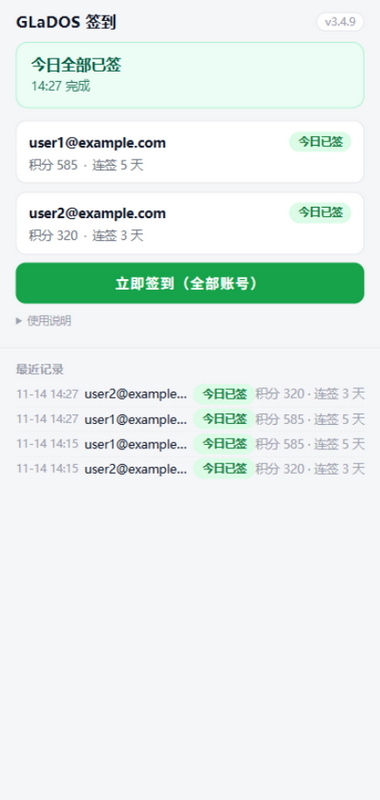
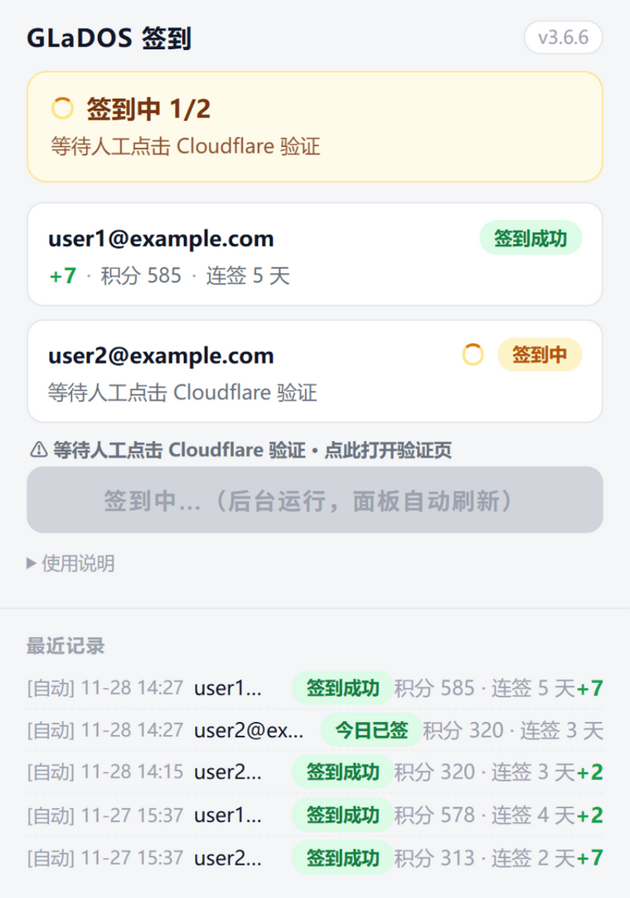

# GLaDOS 签到扩展（Chrome MV3）

[GLaDOS](https://glados.rocks) 多账号自动签到的 Chrome 扩展。利用 GLaDOS **官方多账号切换接口**，在单个浏览器里轮流给所有已绑定账号签到——无需多开浏览器、无需服务器、无需账号密码。

## 特性

- **单浏览器多账号**：`/api/user/accounts` 枚举绑定账号 + `/api/user/accounts/switch` 官方切换，逐账号签到，结束切回原账号
- **真浏览器流程**：完整页面渲染，Cloudflare Turnstile 由真实浏览器通过——不做 HTTP 模拟（纯 HTTP 请求会被判 `device-mismatch`）
- **还原现场**：切回原账号采用官方切换接口 + 身份核实，cookie 快照兜底；还原为锦上添花，失败不影响签到成败
- **稳健调度**：每天 12:15～12:45 / 19:00～19:20 窗口内随机时刻运行（行为更自然）；成功日全天只发一轮；次日启动补签；失败自动重试（≤3 次/天）
- **看门狗**：MV3 Service Worker 被浏览器回收时，90 秒内自动清理现场并标记，绝不卡死
- **人工验证兜底**：遇到 Cloudflare 点击式人机验证时，自动置顶签到页 + 弹系统通知，人工点一下后流程自动继续（验证不可被脚本替代，这是有意的）
- **人味化**：按钮出现后随机停留 0.8~2.5 秒再点击
- **面板**：状态横幅（签到中 / 今日全部已签 / 未完成 / 待签到）+ 每账号邮箱·积分·连签·当日增量 + 历史记录 + 实时进度

## 截图

| 签到完成 | 签到进行中 |
|:---:|:---:|
|  |  |

## 安装

1. 下载本仓库：`Code → Download ZIP` 解压，或 `git clone`
2. Chrome 打开 `chrome://extensions` → 右上角开启 **开发者模式**
3. 点 **加载已解压的扩展程序** → 选择本目录
4. 在 GLaDOS 控制台右上角账号菜单 **「添加账号」** 绑定你的其他账号（扩展只签"已绑定"的账号）

## 工作原理（简）

1. 闹钟唤醒后台 Service Worker → 快照当前 glados cookie
2. 后台标签页打开签到页；并行请求账号列表与身份/积分（`/api/user/info`、`/api/user/points`）
3. 向页面注入两段代码：MAIN world 补丁拦截签到接口响应；隔离探针每秒探测页面状态
4. 按钮出现 → 随机停留 → 点击；Turnstile/proof 全由页面自身完成，拦截响应记录结果
5. 官方接口切换到下一账号 → 重载签到页 → 重复；全部完成后切回原账号
6. 结果/历史/角标落盘；失败挂随机重试闹钟；SW 被回收由看门狗清理

## 隐私与安全

- 只与 `glados.rocks` 通信（`host_permissions` 仅此一个域），**无任何遥测或第三方请求**
- 不存储、不上传密码（GLaDOS 登录为邮箱 + OTP），代码中不含任何凭证
- cookie 快照仅保存在你本机浏览器的扩展存储里，签到结束自动还原

## 常见问题

- **面板显示"未登录"**：会话被官方踢掉了，在控制台重新登录即可，无需其他操作
- **运行期间 glados.rocks 页面会临时切到别的账号**：正常现象，一轮结束后自动切回（约 1 分钟）
- **为什么用后台标签页而不是直接调接口**：新签到流程需要浏览器通过 Cloudflare Turnstile 并在页面内计算 proof，纯 HTTP 请求会被判定为自动化

## 免责声明

- 自动化签到可能违反 GLaDOS 服务条款，请自行评估并承担风险
- 本项目仅供学习研究与个人使用，请勿用于商业用途或大规模部署
- GLaDOS 前端改版可能导致接口变化，本项目会尽力跟进但不保证始终可用

## License

[MIT](LICENSE)
